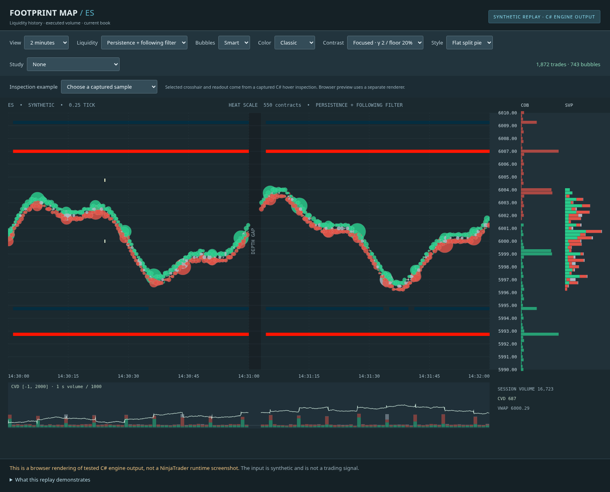

# Footprint Map for NinjaTrader 8

An original C# liquidity heatmap, execution-bubble and order-flow indicator inspired by Bookmap’s classic chart. It uses NinjaTrader’s supplied Level I/II data and the instrument’s actual tick size. Research covers official Bookmap documentation, TraderMap Pro material, chart/settings screenshots, and the uploaded NinjaTrader and Bookmap videos; the delivered feature set is documented separately from that research.



**Validation status:** the user compiled an earlier version in NinjaTrader, then reported runtime/display problems that prompted the current repairs and additions. **This latest revision has not been compiled or run in the genuine Windows/NinjaTrader host here.** Portable core builds, automated tests and a synthetic browser replay are separate evidence; see the [validation report](docs/validation/REPORT.md) for the recorded checks and remaining Windows checks. The image above does not demonstrate the newest adapter controls or every study.

## Delivered features

- Duration-weighted historical Level II heatmap with classic, grayscale and ice palettes; opacity, contrast, quantity/percentile cutoffs, manual ceiling and bounded retention. A 20% contrast floor and exponent 2 keep weaker liquidity dark by default. The adapter copies NinjaTrader’s current instrument depth snapshot, including when attached to an already running feed.
- Raw depth by default; optional fixed-price quantity persistence and following-liquidity suppression. These original aggregate-depth filters do not identify bots or reproduce TraderMap Pro’s MBO Bot Remover.
- Execution bubbles with Pixel, Smart, Time, Volume, Price, Price-and-Side, and Individual modes; separate print and cluster thresholds; total/delta sizing; gradient/split/pie colors and optional 3D appearance. Individual keeps each accepted print separate, even at identical timestamps/prices. Flat pie sectors are the default. Radius uses a fixed reference of 100 contracts/units and size scale 12, so new large prints do not resize completed older bubbles through a changing volume reference.
- Hover details for executed bubble total, buy/sell/unknown volume, delta, price and time range; recorded liquidity shows raw and persistent bid/ask frame averages separately from the rendered heat-bin quantity and recorded best quotes. Hovering a historical bid/ask path highlights its sampled segment. These are captured quantities, not individual order counts.
- A continuous **120-second** viewport by default, with its own time axis, Ctrl+wheel time zoom and Shift+wheel history navigation. Current last-price/bid/ask guides, an optional price badge in its own 90-pixel strip, a dark header and a translucent current-book projection keep the current market readable alongside captured history.
- A collapsible display sidebar with seven sliders: brightness, black cutoff, heat opacity, minimum level quantity, minimum bubble volume, bubble size and heat ceiling. An Auto/Manual button selects the ceiling mode; display changes preserve captured depth and execution totals.
- Optional **run / last** execution quantities: captured consecutive volume at the latest execution price and the last supplied print's size. Price changes, epochs and sessions end the run; `≥` marks possible retention truncation. This defined statistic is separate from resting size and is not claimed to reproduce the unresolved `N (n)` label in the Bookmap recording.
- Current book, captured-session and visible-range volume profiles; cumulative delta with a labeled range/zero reference and fixed-time volume bars (1,000 ms by default); POC, contiguous value area, VWAP/deviation bands, book/volume imbalance and large displayed-level highlights. Lower-panel automatic scales expand at new extremes and reset with the session/recording; fixed limits are available.
- Separate column bars/numbers and alignment controls; current-book bid/ask visibility, per-side depth limits, cumulative quantities and percentage labels. These display choices preserve raw capture and execution accounting.
- Optional bid × ask footprint cells with diagonal imbalance and a captured TPO histogram with POC/value-area highlighting. These use retained executions in the visible time window; they do not reconstruct uncaptured trades or infer visits to untraded prices.
- Original absorption and sweep candidate markers, individual large-print markers, and optional coarse sampled-liquidity-change/replenishment candidates. These are observations of executions and aggregate depth, with configurable thresholds.
- Saved captured heat, executions and session totals, restored on reopening with compatible capture settings. Autosave is enabled by default, runs every 30 seconds and on indicator removal, and writes under `NinjaTrader 8/FootprintMapHistory` in the actual NinjaTrader user-data folder. Restoring history requires fresh depth before a live book is shown.
- Feed/reset/coverage status, session resets, reconnect gaps, replay rewind handling, render-resource cleanup, and explicit memory/render limits.

The portable [MBO engine](src/Footprint.Core/MboEngine.cs) additionally supports normalized order-ID reconstruction, individual-order filtering, large-lot traces and same-ID refill candidates. **It has no live vendor bridge or NinjaTrader MBO integration.** The running indicator uses aggregate market-by-price (MBP) depth. A Rithmic connection or MBO entitlement alone does not expose order IDs through ordinary NinjaScript Level II callbacks. See the [MBO integration contract](docs/research/mbo-integration-contract.md).

## Instruments and capture limits

There is **no symbol whitelist**. Futures including NQ, ES, GC, YM, RTY, 6E, 6B and DAX-family contracts use their NinjaTrader instrument metadata for tick normalization and price formatting. Volumes are whole units/contracts. Feed entitlements, contract availability, supplied depth levels and instrument definitions determine actual coverage; thresholds should be tuned per contract. Generic tick-size support does not certify every exchange, connection or instrument in Windows.

**Maximum depth levels per side** defaults to 200 and accepts up to 2,000; zero COB bid/ask row limits show all captured rows. Increasing either limit cannot create depth that the provider or account entitlement does not supply.

History contains only data actually captured while the indicator was receiving events, plus compatible saved capture. OHLC history and Tick Replay do not supply historical Level II. Retention and capacity limits can trim earlier heat/trades; captured session profile totals are maintained separately from retained individual executions. Disk capture is a bounded snapshot, not an unlimited recorder or an import of Bookmap/vendor history.

Persistence requires quantity to survive at an absolute price and can suppress legitimate short-lived or moving liquidity. Following suppression is an optional heuristic for large quantities recurring at a relative distance from the market; it can suppress legitimate responsive liquidity too. Start with raw heat, and compare filters with a fixed manual ceiling when comparing absolute brightness. Filtering does not change the raw current book, accepted trades or profile/CVD totals.

Bubble grids use absolute event-time/price bins so ordinary panning at unchanged resolution preserves completed, fully retained interior groups. Zoom or resizing can change aggregation; an unfinished live group can grow, and a group cut by the viewport or retention boundary can be partial. Volume clustering has configurable 60-second anchors to limit how far a trimmed early group can shift later grouping. Stable lower-panel scaling does not shrink while browsing, but newly encountered historical or live extremes can expand it; use positive **Fixed CVD half-range** and **Fixed volume maximum** for exact limits.

## Install and validate on Windows

Follow [INSTALL-NINJATRADER.md](docs/INSTALL-NINJATRADER.md). The source ZIP is a normal archive, **not** a NinjaTrader `Import NinjaScript Add-On` package.

1. With NinjaTrader closed, copy all **ten** core files from `src/Footprint.Core` into `bin/Custom/Indicators/FootprintMapCore`: `Model.cs`, `MarketEngine.cs`, `Visualization.cs`, `LiquidityNoiseFilter.cs`, `HistoryStore.cs`, `ProfileStudies.cs`, `OrderFlowStudies.cs`, `MboEngine.cs`, `HoverInspection.cs`, and `LowerPanel.cs`.
2. Copy `src/NinjaTrader/FootprintMap.cs` into `bin/Custom/Indicators`. Keep backups outside `bin/Custom` to avoid duplicate types.
3. Reopen NinjaTrader and compile once after all **eleven** source files are in place. Add FootprintMap to a chart with entitled Level II, initially using raw heat and the 120-second continuous viewport. Older templates retain saved settings; apply the [update settings](docs/INSTALL-NINJATRADER.md#4-start-with-a-seconds-view) explicitly for the new heat/bubble defaults.

The continuous view uses its labeled inner time axis; the right-side price scale remains NinjaTrader’s scale and may need zooming near the market. Keep the background and covering z-order enabled because native bars use different horizontal coordinates. Disabling continuous mode restores native minute/second bar alignment and requires at least two visible time bars plus enough right margin for the enabled columns. The shaded area after **NOW** is a display of current observed depth, not historical backfill.

An optional [reference-compilation project](src/Footprint.NinjaTrader.Validation/Footprint.NinjaTrader.Validation.csproj) and [PowerShell runner](scripts/validate-ninjatrader.ps1) use DLLs from a genuine installation. No vendor binaries or fake API shims are included. This external build supplements NinjaScript Editor and live/playback validation.

The latest NinjaTrader release could not be confirmed from vendor pages because they returned HTTP 403. A public documentation mirror records **8.1.8.2 (August 11, 2026)**; this is an observed version, not a certified current release. See the [platform investigation](docs/research/ninjatrader-platform.md).

## Reproduce the cloud checks

```bash
cd /workspace/FootprintIndicator
bash scripts/bootstrap-dotnet.sh
bash scripts/run-checks.sh
python3 scripts/check-preview.py  # optional: installed Playwright + Chromium required
python3 scripts/package-source.py
```

The pinned Microsoft .NET SDK is 8.0.426. The bootstrap preserves HTTPS and verifies Microsoft’s published SHA-512. The core targets `net48`, `netstandard2.0`, and `net8.0`, using C# 7.3. Tests execute on .NET 8; NinjaTrader uses its own Windows/.NET Framework host.

`run-checks.sh` builds the core, runs deterministic and randomized tests, parses the shipped C# as C# 7.3, and processes a synthetic replay through the actual engine to generate `artifacts/footprint-preview.html`. The preview is an independent browser renderer of those C# scenes. `check-preview.py` exercises its display controls and captures reference screenshots. These checks need no trading account or credentials, and do not resolve NinjaTrader vendor APIs or prove live-feed behavior.

## Research and coverage

- [Research index](docs/research/README.md)
- [Bookmap feature and settings catalogue](docs/research/bookmap-feature-catalogue.md)
- [Bookmap visuals and settings](docs/research/bookmap-visuals.md)
- [Actual screenshots and decoded demonstration frames](docs/research/bookmap-motion-evidence.md)
- [Uploaded NinjaTrader and requested Bookmap video review](docs/research/uploaded-video-review.md) — inspected decoded frames; no audio review
- [October 29 Bookmap zoom, sliders and hover review](docs/research/bookmap-oct29-video-review.md) — exact frame offsets and limits of the parenthesized-number evidence
- [TraderMap Pro, liquidity filtering, and bubbles](docs/research/liquidity-and-bubbles.md)
- [Feature coverage and limitations](docs/FEATURE-COVERAGE.md)
- [MBO input contract and integration requirements](docs/research/mbo-integration-contract.md)
- [Validation evidence and remaining platform checks](docs/validation/REPORT.md)

Bookmap’s native Smart clustering, Bot Remover, normalization and bubble-size formulas are not public. This project implements and documents its own behavior. It does not claim proprietary algorithm parity, every Bookmap add-on, native stop/iceberg identification, or unknown hidden order quantity.
