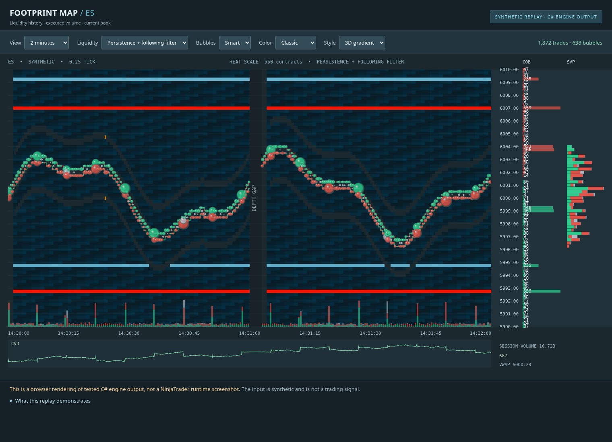

# Footprint Map for NinjaTrader 8

An original C# liquidity heatmap and execution-bubble indicator inspired by Bookmap’s classic chart. The research includes official Bookmap documentation, TraderMap Pro material, and inspection of actual chart/settings screenshots.



**Development preview:** the portable engine is compiled and tested, including a .NET Framework 4.8 build. The NinjaTrader adapter is source-complete but has **not yet been compiled against a genuine NinjaTrader installation or run in its Windows chart host**. Read the [validation report](docs/validation/REPORT.md) before installation. No claim of identical proprietary algorithms or bug-free operation is made.

## What is implemented

- Duration-weighted historical Level II heatmap with the classic dark/blue/pale/yellow/orange/red palette, alternative palettes, opacity, contrast, manual ceiling, percentile cutoff, and bounded retention.
- Raw depth, causal fixed-price quantity persistence, and an optional following-liquidity heuristic for large bands repeatedly moving at the same distance from the market. The latter is an original MBP approximation, not TraderMap Pro’s MBO Bot Remover.
- Executed-volume bubbles with Pixel, Smart, Time, Volume, Price, and Price-and-Side grouping; separate individual-print and aggregate thresholds; total/delta sizing; gradient/split/pie colors; 2D/3D appearance; unknown aggressor accounting.
- Best bid/ask traces, current order book, session and visible-range profiles, cumulative delta, volume bars, and session VWAP.
- Feed/reset/coverage status, session handling, reconnect gaps, replay rewind handling, instrument tick-size normalization, render-resource cleanup, and explicit memory/render limits.

The baseline consumes NinjaTrader’s normalized Level I/II events. It is intended for **NQ, ES, GC, YM, and RTY**, initially using the user’s NinjaTrader trial feed and later other supported connections such as Rithmic. Each account must actually supply Level II for the selected contract. Individual order IDs, broker identity, exchange-native iceberg/stop detection, and hidden depth cannot be reconstructed from aggregated Level II.

## Install and validate on Windows

Follow [INSTALL-NINJATRADER.md](docs/INSTALL-NINJATRADER.md). The source distribution is a normal ZIP, **not** a NinjaTrader `Import NinjaScript Add-On` archive. Copy the helper sources and indicator into the documented Custom/Indicators locations, then compile in NinjaScript Editor.

An optional [reference-compilation project](src/Footprint.NinjaTrader.Validation/Footprint.NinjaTrader.Validation.csproj) and [PowerShell runner](scripts/validate-ninjatrader.ps1) use DLLs from your genuine installation. No vendor binaries or fake API shims are included. This external build does not replace NinjaScript Editor or live/playback validation.

The latest NinjaTrader release could not be confirmed from its vendor pages because they return HTTP 403. A public documentation mirror records **8.1.8.2 (August 11, 2026)**; that is the newest observed version in that source, not a certified current-release claim. See the [platform investigation](docs/research/ninjatrader-platform.md).

## Reproduce the cloud checks

```bash
cd /workspace/FootprintIndicator
bash scripts/bootstrap-dotnet.sh
bash scripts/run-checks.sh
python3 scripts/check-preview.py  # optional: installed Playwright + Chromium required
python3 scripts/package-source.py
```

The pinned Microsoft .NET SDK is 8.0.426. The bootstrap preserves HTTPS and verifies Microsoft’s published SHA-512. The core builds for `net48`, `netstandard2.0`, and `net8.0`, using C# 7.3. Tests run on .NET 8; this does not imply NinjaTrader runs on .NET 8.

`run-checks.sh` builds the core, runs the deterministic and randomized tests, parses all shipped C# as C# 7.3, and processes a synthetic replay through the actual engine to generate `artifacts/footprint-preview.html`. The preview is an independent browser renderer of those C# scenes, not a screenshot from NinjaTrader. `check-preview.py` checks the display controls and captures reference screenshots. No trading account or credentials are needed for these checks.

The Linux runtime may need write access to its per-user `.dotnet` synchronization directory and NuGet migration directory. If the managed sandbox denies those specific writes, request the required filesystem access; do not change `HOME` or disable verification.

## Research and known differences

- [Research index](docs/research/README.md)
- [Bookmap visuals and settings](docs/research/bookmap-visuals.md)
- [TraderMap Pro, liquidity filtering, and bubbles](docs/research/liquidity-and-bubbles.md)
- [NinjaTrader APIs and release evidence](docs/research/ninjatrader-platform.md)
- [Feature coverage and limitations](docs/FEATURE-COVERAGE.md)
- [Validation evidence and remaining platform checks](docs/validation/REPORT.md)

Native Bookmap Smart clustering, Bot Remover, normalization, and bubble-size formulas are not public. This implementation documents its own behavior. Supported NinjaTrader chart mode is ordinary minute/second bars with at least two visible time bars; historical depth starts when this indicator captures it. Tick Replay/OHLC history is not historical Level II. Capture is in memory and ends with the indicator instance; persistence to disk is not implemented.
