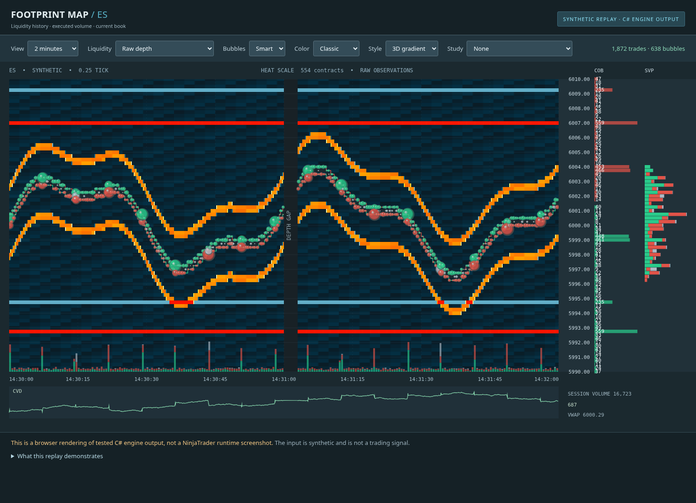
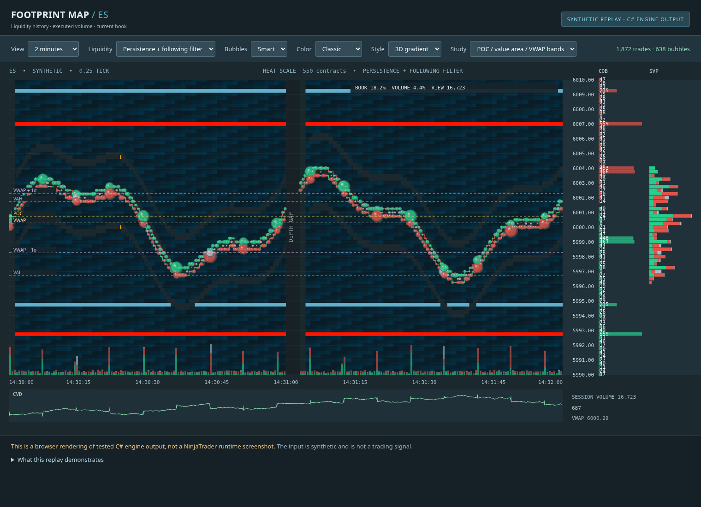

# Validation report — October 28, 2026

The expanded portable engine builds and its automated tests pass. The revised NinjaTrader adapter passes C# 7.3 syntax parsing. **The latest adapter still needs compilation and execution inside genuine Windows NinjaTrader.** These checks do not certify a bug-free indicator, every feed, or pixel identity with Bookmap.

The user compiled and ran the earlier version after the `Viewport` namespace fix. Their ES/GC screenshots exposed real integration failures: positional depth reconstruction remained empty after joining a live subscription, recent capture occupied a tiny portion of a native minute chart, and current price was difficult to locate. The revisions address those failures in source. The earlier run is not acceptance evidence for the new changes.

## Executed checks

| Check | Observed result | What it establishes |
| --- | --- | --- |
| SDK/bootstrap | Microsoft .NET SDK 8.0.426; bootstrap repeat succeeded | Pinned Linux development tooling, originally installed with published SHA-512 verification |
| Locked dependency restore | Core, tests, replay and syntax-check projects restored successfully with `--locked-mode` | Lockfiles are usable with the prepared tooling |
| Core compilation | `net48`, `netstandard2.0`, `net8.0`; 0 warnings, 0 errors | Real C# compiler/reference checks, including official .NET Framework 4.8 reference assemblies; not NinjaTrader APIs |
| Engine and visual model tests | **62 passed, 0 failed, 0 skipped; 6,817 assertions** | Deterministic, randomized, boundary, concurrency, archive and study behavior listed below |
| C# 7.3 parsing | All 9 core/indicator source files; 0 syntax errors | Language syntax compatibility; no vendor API resolution |
| Synthetic event replay | 61,060 depth events; 1,872 executions; 468 heat frames; 0 invalid or late events | Replay exercises the actual C# engine, visual model, profile and flow studies |
| Replay accounting | Session volume 16,723; CVD 687 | Stable totals across the supplied views; unknown aggressor remains separately accounted |
| Browser preview | **124 control combinations**, 0 JavaScript errors | Baseline zoom/filter/grouping/palette/style combinations plus eight study views at two zooms; unchanged source execution count |
| Genuine NinjaTrader reference build | **Blocked**: preflight exits with `Set NinjaTraderBin to the bin folder of your genuine NinjaTrader installation` | Required vendor assemblies are absent; no fake API shims substituted |
| Revised Windows installer / NinjaScript Editor / chart runtime | **Not run here** | Requires the user's genuine Windows/NinjaTrader installation and entitled feed |

The core tests execute on .NET 8. The .NET Framework 4.8 target was compiled, not executed under Windows CLR in this environment. Informational timing checks are not NinjaTrader performance benchmarks. The browser is Chromium controlled by Playwright and uses a temporary internal HTTP server that the check shuts down.

## Behaviors covered by tests

- Tick-size normalization including fine currency, fractional and negative prices; positional add/update/remove ladders, opposite-side ordering, 2,000 randomized operations against an independent ladder model, malformed positions and removal prices.
- Authoritative depth snapshots: joining mid-stream, zero-volume positional slots, invalid/duplicate rows, atomic validation, retained-depth limits and preservation of unchanged quantity ages.
- Finite provider-depth limits and reentry, retained-prefix integrity, no artificial history at changing ladder indices, and conservative handling of unavailable depth.
- Exact duration integration, persistence maturation within a frame, newly added quantity, reductions, disappearing/reappearing levels, cohort limits, and no historical backpainting from later survival.
- Disconnect/reset gaps, side-specific invalidation, session reset accounting, bounded frame/trade/profile retention, concurrent snapshots, late timestamps, invalid future events, large time jumps, `DateTime` boundaries and transactional 64-bit overflow rejection.
- All six bubble grouping modes at three zooms; conservation of buy/sell/unknown volume; weighted centers; separate print/cluster thresholds; zero delta; one-contract delta at large totals; half-open viewport boundaries; visible profiles independent of bubble filters.
- Heatmap time weighting, viewport clipping, contrast/palette behavior, raw/persistent differences, gap preservation and deterministic rendering.
- Following-liquidity suppression: prior-frame evidence, distinct price moves, size coherence, fixed-wall preservation, warm-up and reset behavior, setting validation, and unchanged raw book/trade/profile accounting. It is an original heuristic; these tests cannot establish which real-market orders are bots.
- Session versus visible profiles; contiguous value area, deterministic POC, volume-weighted variance and bands, imbalances, fixed-time footprints and print-based TPO counts. Earlier trimmed executions are not invented.
- Causal fixed-price absorption candidates, distinct-price sweeps, individual large prints, session/epoch boundaries, marker budgets and completed-frame liquidity/replenishment estimates. Native parent orders, stops and hidden reserve sizes are not inferred.
- Standalone normalized MBO order-ID state: sequence gaps fail closed, atomic updates, snapshot replacement, order-size/age filtering, bounded traces and same-ID refill candidates. **No NinjaTrader MBO bridge is connected.**
- Checksummed capture archives, hostile lengths/counts, corruption, truncation, configuration keys, bounded decoding, atomic replacement, concurrent readers/writers and protection against older timestamps overwriting newer captures. Restored history contains no live book; fresh observation starts a new epoch.

The adapter now reads NinjaTrader's authoritative `Instrument.MarketDepth` collection instead of requiring a complete initial sequence of positional adds. Tests establish the portable engine's behavior with these inputs; a genuine platform run must establish callback timing and provider behavior. Session counters follow observed Trading Hours boundaries. Review also covers timer teardown, negative quotes, price-scale contributions and panel-scoped wheel handling; source review cannot replace executing those platform paths.

## Visual evidence

These are **our synthetic replay rendered in a browser**, using scenes generated by the C# engine. They are not Bookmap captures or NinjaTrader screenshots. Source Bookmap images were inspected separately; citations and observations are in the [visual research](../research/bookmap-visuals.md).

Raw depth contains large moving bands on either side of price:



Persistence plus the optional following filter suppresses the moving bands after its evidence window. Fixed-price walls, the three-second observation gap, and execution totals remain:


The [30-second detail image](preview-detail.png) shows reaggregation after zoom with pie bubbles. [Absorption examples](preview-studies.png) label passive-side candidates separately from execution bubbles. Profile levels use the selected accumulation scope:



Fixed-wall and moving-band behavior in this constructed fixture does not establish the same discrimination on a real feed. Color scale is recalculated after filtering; use a manual maximum when comparing absolute intensity. Dense labels can overlap; label visibility and thresholds are configurable. Actual Bookmap images and decoded official demonstration frames are recorded in the [motion evidence](../research/bookmap-motion-evidence.md).

The generated interactive artifact is `artifacts/footprint-preview.html`. It is standalone and can be opened locally after download. It is generated rather than committed because it embeds about 57 MB of replay scenes. Screenshots and the [browser check result](preview-checks.json) are committed. [Full build/test output](engine-checks.txt) records the executed run.

## Remaining platform acceptance checks

Follow [the Windows installation guide](../INSTALL-NINJATRADER.md). Replace the adapter and **all eight core helpers**, then compile once with F5. NinjaTrader compiles all Custom scripts together. Optionally run `scripts/validate-ninjatrader.ps1` against genuine installed DLLs.

1. Compare raw COB quantities with a native Level II window for the identical contract. Attach mid-stream, remove/re-add, reconnect, and confirm depth recovers without increasing position-gap errors.
2. Start with raw heat and the 120-second continuous viewport. Check continuous bands, price guides, NOW/current-depth projection, Ctrl-wheel zoom and Shift-wheel history on second and minute host charts. Test native bar alignment separately.
3. Let capture autosave, reload, and confirm history returns with a gap until fresh depth. Test session boundaries and replay seeking. OHLC and Tick Replay cannot provide missing historical Level II. Older playback must not replace a newer saved capture.
4. Resize, change DPI, switch tabs, and remove/re-add the indicator. Check Output/Log for errors and optional study/column controls for consistent source totals.
5. Repeat on NQ/ES, GC, YM/RTY, currency and DAX-family contracts as available, and after changing provider. Record the actual platform version, feed, entitlements, instrument metadata and settings.

Official NinjaTrader pages returned vendor HTTP 403 during research. A secondary documentation mirror observes 8.1.8.2 dated August 11, 2026; **the latest vendor release is not confirmed**. The managed environment is Linux and does not contain a licensed/current Windows NinjaTrader installation. Downloading unrelated third-party binaries would not establish current vendor compatibility.

Bookmap-specific proprietary algorithms and MBO features have a separate data boundary. The [coverage table](../FEATURE-COVERAGE.md) lists the actual implementation and omissions. Neither the following filter nor fixed-price persistence identifies individual orders or guarantees that retained liquidity will execute.

## Reproduction

```bash
cd /workspace/FootprintIndicator
bash scripts/bootstrap-dotnet.sh
set -o pipefail
bash scripts/run-checks.sh 2>&1 | tee artifacts/checks.log
python3 scripts/check-preview.py
python3 scripts/package-source.py
```

The browser check needs installed Python Playwright and Chromium. The source ZIP includes the sources, research, screenshots, tests and Windows scripts; it is a normal source distribution, not a NinjaScript import archive. SHA-256 is emitted beside it.

Reusable installation/start instructions are saved separately in the environment configuration. Saving a draft does not publish it or validate a fresh task. GitHub's branch **Code → Download ZIP** provides a source-download path if the chat artifact download fails.
